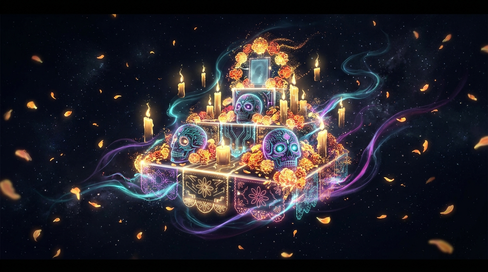

# 💀 Spiritus — Virtual Ofrenda Builder

> *"The dead are never truly gone as long as they are remembered."*

**Spiritus** is a full-stack web app built for the [Hacktoberfest 2026 Open-Source AI Challenge: Ghost in the Machine](https://dev.to/challenges/hacktoberfest-week4-2026-10-26). It lets you build a digital *ofrenda* (altar) and generate a heartfelt, AI-written remembrance for someone you've loved and lost — all running **100% locally on your machine**, with zero cloud, zero data collection.



---

## ✨ Features

| Feature | Details |
|---|---|
| 🕯️ **Interactive Altar Builder** | Add offerings, names, dates, and memories — the altar preview updates live |
| 🪶 **Tone & Style Controls** | Choose between Poetic, Celebratory, Solemn, or Storyteller styles |
| 🔊 **Recite Aloud (TTS)** | Hear the remembrance read aloud with gentle browser speech synthesis |
| 🤖 **Local AI Generation** | Runs Gemma 3 / Mistral / LLaMA via [Ollama](https://ollama.com) — no API key needed |
| 📡 **SSE Streaming** | Remembrances stream token-by-token like a typewriter |
| 💬 **Multi-turn Chat** | Continue the conversation: ask for a poem, translate, change the tone |
| 🎭 **Demo Mode** | No Ollama? Try the built-in demo mode with full tone selection |
| 💾 **Save & Export** | Download as `.txt` and persist altar data to local file storage |
| 🔄 **Draft Auto-save** | Automatic `localStorage` draft saving prevents losing progress |
| 🌐 **Full-stack** | Express backend + Vanilla JS frontend — zero build step |
| 🔒 **100% Offline** | Your words, your machine — nothing leaves the device |

---

## 🚀 Quick Start

### 1. Clone & install

```bash
git clone <your-repo-url>
cd spiritus
npm install
```

### 2. Start Ollama (optional but recommended)

```bash
# Install Ollama from https://ollama.com
ollama serve          # in one terminal
ollama pull gemma3:4b # in another
```

### 3. Run Spiritus

```bash
npm start
# or for auto-reload:
npx nodemon server.js
```

Open [http://localhost:3000](http://localhost:3000) 🌼

---

## 🏗️ Architecture

```
spiritus/
├── server.js          # Express backend
│   ├── GET  /api/health
│   ├── GET  /api/ollama/status
│   ├── GET  /api/ollama/models
│   ├── POST /api/generate     ← SSE streaming (Ollama /api/generate)
│   ├── POST /api/chat         ← SSE streaming (Ollama /api/chat)
│   ├── POST /api/demo         ← Canned response, no Ollama needed
│   └── POST /api/ofrenda/save ← Persist ofrenda JSON
│
└── public/
    ├── index.html   # Single-page app
    ├── style.css    # Full design system
    ├── app.js       # Frontend: particles, streaming, chat, offerings
    └── hero.jpg     # Generated hero image
```

---

## 🧠 Open-Source AI Used

| Component | Tool |
|---|---|
| Language Model | **Gemma 3 4B** (Google, open-weight) |
| Local Inference | **Ollama** (open-source runtime) |
| Alternative models | `gemma3:1b`, `llama3.2:3b`, `mistral:7b` |

### Why open innovation matters here

- **Privacy by design** — A remembrance for a loved one is among the most personal content you can write. Closed APIs send your words to a server. Ollama doesn't.
- **Works offline** — Light a digital candle even when the internet is out. The model runs on your GPU/CPU, period.
- **No subscription** — Grief doesn't need a billing cycle. Open weights are free to run forever.
- **You can fine-tune it** — Train on your family's letters. The model belongs to you.
- **It won't disappear** — Closed services shut down. A local `.gguf` file lives as long as you keep it.

---

## 🎨 Theme: Ghost in the Machine

This week's theme is **Halloween + Día de los Muertos**. Spiritus interprets it as the intersection of:

- 🌼 *Día de los Muertos* — the tradition of building ofrendas to honor the dead
- 👻 *Ghost in the Machine* — AI running locally, invisibly, on your own hardware
- 💀 *Memory as code* — writing remembrances that outlast any cloud service

---

## 📜 License

MIT — free to fork, modify, and run forever.

---

*Built for Hacktoberfest 2026 · Tags: #devchallenge #hf26challenge*
